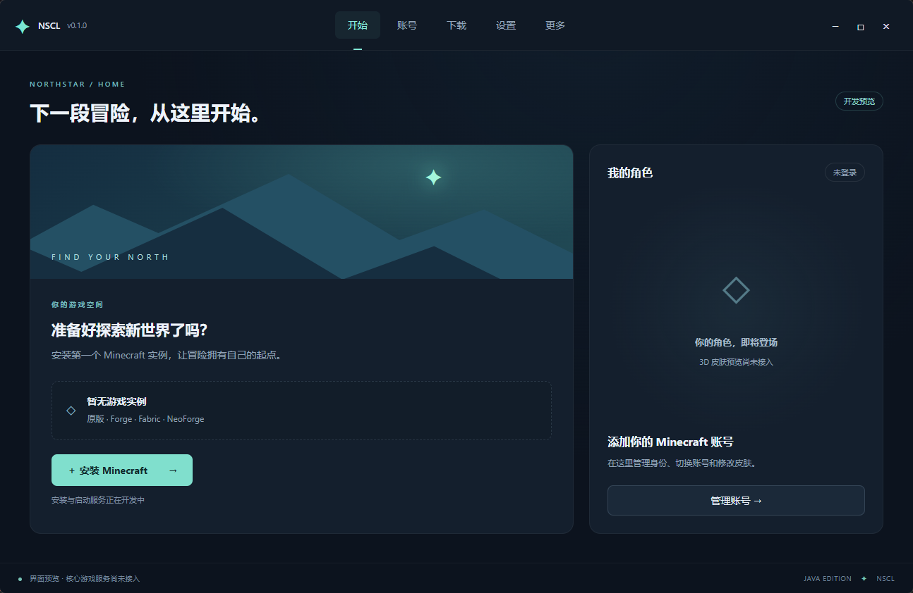
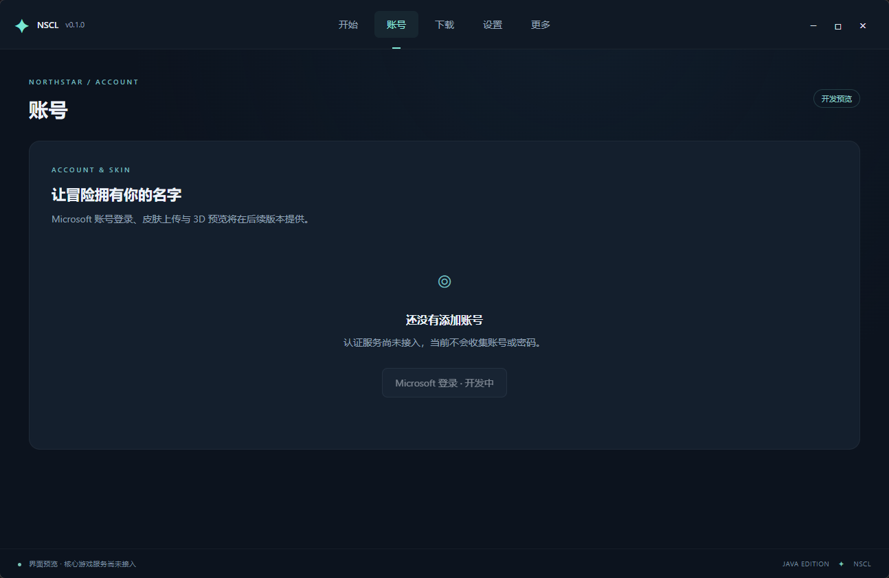
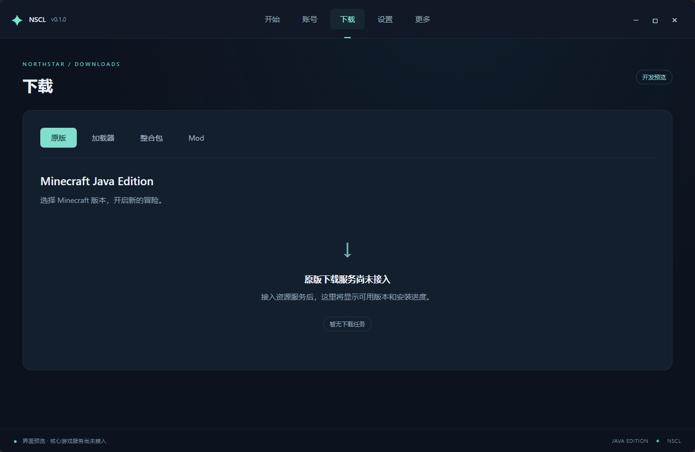
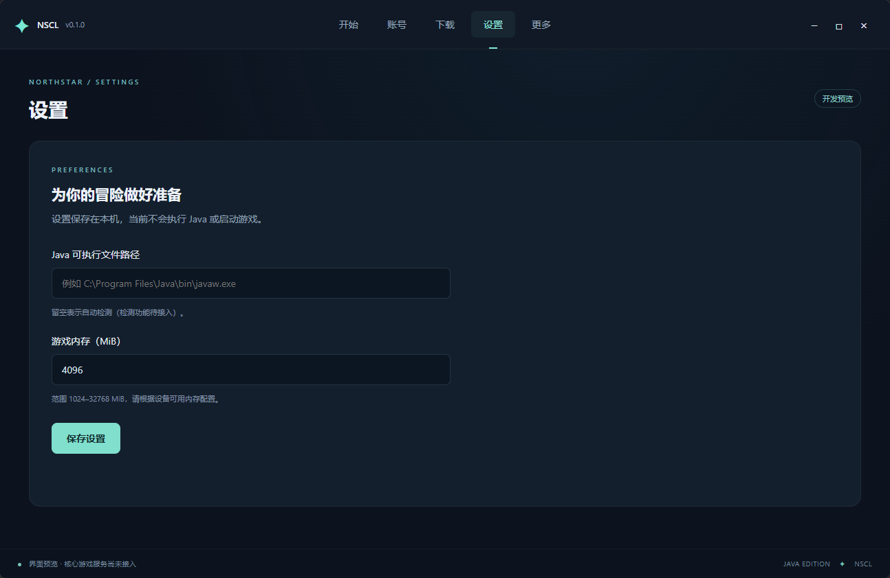

# NorthStar Minecraft Launcher（NSCL）

NorthStar Minecraft Launcher，简称 **NSCL**，是一款使用 **Rust** 编写的 Minecraft 启动器，旨在提供游戏启动、客户端安装、模组资源下载与皮肤管理等功能。

项目面向 **Minecraft Java Edition**，希望将游戏版本、模组环境与角色皮肤管理集中到同一个启动器中。

## 项目状态

**当前处于功能开发阶段。** 已建立纯 Rust 桌面工程（eframe/egui），支持原版及 Forge / Fabric / NeoForge 安装启动、Microsoft 正版登录、Java 配置与独立实例管理。模组下载及皮肤渲染尚未实现，暂无正式安装包。

- 已实现：基础界面、本地设置、原版和三种加载器安装启动、Microsoft 浏览器 PKCE 登录与续期、备用设备代码登录、多账号切换、Java 检测、实例独立配置与归档恢复、下载进度与日志查看。
- UI 方案：Rust + eframe/egui（无 WebView、无 JavaScript）；首批支持的平台仍待确定。
- 构建与运行说明见下文「使用与开发」。

项目仓库：[CNB · NorthStar Minecraft Launcher](https://cnb.cool/JeffreyMing/NorthStar-Minecraft-Launcher)

## 技术栈

- **核心语言**：Rust（界面与业务逻辑全部为 Rust，无 WebView 与前端脚本）
- **界面框架**：eframe/egui
- **数据持久化**：serde / serde_json（JSON 设置文件）
- **网络与文件校验**：reqwest（系统 TLS / 代理）、SHA-1、ZIP 原生库解压

## 原版客户端使用

在「设置」选择 **Mojang 官方源、BMCLAPI（bangbang93）、mirror.minguncle.cn 或自定义镜像**，保存后打开「下载 → 原版」即可自动加载版本列表，搜索并安装版本。完成后在「开始」选择版本并启动；镜像失败时默认回退官方源。

在「账号」点击 **登录 Microsoft 账号**，启动器会打开系统浏览器，授权后通过本机回调自动接收授权码并完成正版身份验证。默认应用 Client ID 为 `0c342b6c-38ee-414d-8f83-8df917817e2b`，默认回调为 `http://localhost:29111/auth-response`，均可在设置中修改；应用需支持个人账号，并将回调登记在「移动和桌面应用程序」平台，还需获得 Minecraft Java API 访问权限。浏览器登录使用 PKCE，不需要 Client Secret；设备代码登录位于「其他登录方式」，仅在应用启用了该流程时使用。真实账号授权及应用权限需在实际环境验证，自动测试使用本地模拟认证服务。

Java 可以自动匹配，也可扫描后选择或填写路径，启动前检查主版本与架构。在「开始 → 管理实例」创建、重命名实例并配置独立 Java 和内存，支持打开目录、归档与恢复。账号凭据由 Windows/macOS 系统凭据库保存；其他平台目前仅支持会话登录。离线测试身份需在账号页明确选择。

详细说明、镜像接口约定、文件目录、修复机制与命令行用法见 [原版客户端安装与启动](docs/vanilla-client.md)。

## 加载器安装

打开「下载 → 加载器」，选择 **Forge、Fabric 或 NeoForge** 和 Minecraft 版本，从兼容版本列表安装。启动器会先安装或校验对应原版，再下载加载器依赖、处理补丁并生成独立实例；完成后在「开始」选择该实例启动。修复同一加载器版本会保留实例的模组、配置和存档，不会把现有原版实例转换为模组实例。

Fabric 使用官方 Meta 接口。Forge / NeoForge 的官方 Java 补丁处理器通过所需版本的 Java 在后台运行，启动器界面与调度仍全部使用 Rust。沿用设置中的官方源、BMCLAPI、明叔镜像或自定义 BMCLAPI 兼容镜像，失败时按设置回退官方。加载器安装不会自动安装 Fabric API 或其他 Mod。

协议、版本支持、Java 要求、安装日志和 CLI 示例见 [加载器安装与启动](docs/loaders.md)。

## UI 方案

采用 **纯 Rust 原生界面（eframe/egui）**。顶部左侧展示 `NorthStar Minecraft Launcher (v{version})`，空间不足时切换为 `NSCL (v{version})`；中间依次为 **开始 / 账号 / 下载 / 设置 / 更多**，右侧为窗口控制按钮，无边框窗口由应用自绘标题栏。

首页以实例选择和启动游戏为主要操作，右侧提供账号摘要与角色皮肤预览占位。项目早期曾以 Tauri 2 + Vue 3 实现界面原型，2026-10 起切换为 egui，以实现「启动器全部由 Rust 编写」的目标；取舍记录见 [UI 方案草案](docs/ui-design.md)。

### 界面参照图

以下为五个导航页面的界面参照图（位于 `image/` 目录），展示各页面的布局与视觉方向：

| 开始 | 账号 |
| :---: | :---: |
|  |  |

| 下载 | 设置 | 更多 |
| :---: | :---: | :---: |
|  |  |  |

## 规划功能

以下列出项目的完整目标；已实现的客户端与加载器流程见上文，其余功能进度以开发路线为准。

### 游戏启动与安装

- 启动 Minecraft 游戏。
- 下载与安装 Minecraft 原版客户端。
- 安装 Forge、Fabric 和 NeoForge 模组加载器。

### 整合包与模组

- 下载 Minecraft 整合包。
- 下载 Minecraft 模组（Mod）。

### 皮肤管理与预览

- 修改 Minecraft 角色皮肤。
- 在启动器内渲染并预览角色皮肤。

## 仓库同步

CNB 为主仓库，GitHub 为镜像。

- 主仓库：[CNB · NorthStar Minecraft Launcher](https://cnb.cool/JeffreyMing/NorthStar-Minecraft-Launcher)
- 镜像：[GitHub · NorthStar Minecraft Launcher](https://github.com/JeffreyMing/NorthStar-Minecraft-Launcher)
- CNB 上任意分支 `push`、推 `tag` 都会自动同步到 GitHub；提交记录请以 CNB 为源
- 需要先在 CNB 配置 `GITHUB_USERNAME`、`GITHUB_TOKEN` 两个密钥，详见 [CNB → GitHub 自动同步](docs/github-sync.md)

## 配套功能规划

为支持上述核心功能，计划逐步完善以下能力，具体范围与优先级将在开发中调整：

- **账号管理**：支持 Microsoft 账号登录与游戏身份验证，为在线游戏和皮肤修改提供支持。
- **实例管理**：为不同游戏版本和整合包使用独立目录，分别管理模组、配置与存档。
- **Java 与启动设置**：选择 Java 运行环境，配置游戏内存及启动参数。
- **下载管理**：展示下载进度、失败原因与重试入口，并校验下载文件的完整性。
- **兼容性检查**：安装模组或整合包时检查 Minecraft 版本与模组加载器要求。
- **日志与故障排查**：提供启动日志和错误信息，便于定位游戏启动失败等问题。

## 开发路线

以下为初步开发顺序，不代表发布日期承诺：

- [x] 建立仓库并编写项目 README。
- [x] 确定 UI 方案，搭建 Rust 工程与基础界面。
- [x] 界面层切换为纯 Rust（egui），移除 WebView 与 JavaScript。
- [x] 实现原版客户端下载、校验、安装修复与离线测试启动流程。
- [x] 完善账号登录、Java 配置与实例管理（真实正版授权需应用权限和用户授权）。
- [x] 接入 Forge、Fabric 和 NeoForge 安装、修复与独立实例启动流程。
- [ ] 实现模组与整合包下载及兼容性检查。
- [ ] 实现角色皮肤修改与启动器内渲染预览。
- [ ] 完善错误处理、测试、打包与使用文档。

## 使用与开发

需要 Rust 工具链（rustup 安装的 stable 即可）。Windows 需要 Microsoft C++ Build Tools，其他平台请参阅 [Rust 安装说明](https://www.rust-lang.org/tools/install)。

```powershell
cargo run             # 编译并启动桌面窗口
cargo build           # 调试构建
cargo build --release # 发布构建（暂未配置安装包打包）
cargo fmt             # 格式化代码
cargo clippy          # 静态检查
cargo test --lib       # 原版下载、安装与启动核心回归测试
```

首次编译需要下载 Rust 依赖并完成本地编译，耗时较长。界面中的中文字体在运行时从系统字体目录加载，无需随包分发。

设置保存在本机 JSON 文件：调试构建存于可执行文件旁，发布构建存于 `%LOCALAPPDATA%\cool.cnb.jeffreyming.nscl`；不会存储账号令牌。

项目结构：`src/` 为 Rust 源码，`minecraft/` 为下载、安装与启动核心，`service.rs` 为界面后台任务，`bin/nscl-cli.rs` 为共用核心的命令行入口。`docs/` 为设计与使用文档，`image/` 为界面参照图。应用版本从 `Cargo.toml` 读取。

## 参与贡献

欢迎通过项目仓库反馈功能建议、使用问题或提交代码改进。

- **功能建议**：描述使用场景、期望行为，以及希望解决的问题。
- **问题反馈**：提供启动器版本、操作系统、Minecraft 版本、模组加载器版本和复现步骤；如有日志，请先移除账号令牌、个人路径等敏感信息。
- **代码贡献**：较大的功能改动建议先讨论设计与范围，并为提交附上变更说明和验证方式。

## 项目说明

NSCL 是独立的非官方项目，与 Mojang Studios 或 Microsoft 无隶属或背书关系。Minecraft 及相关名称、商标归其各自权利人所有。

## 许可证

项目许可证尚未确定，仓库暂未提供 `LICENSE` 文件。确定后将在此更新授权方式与许可证链接。
