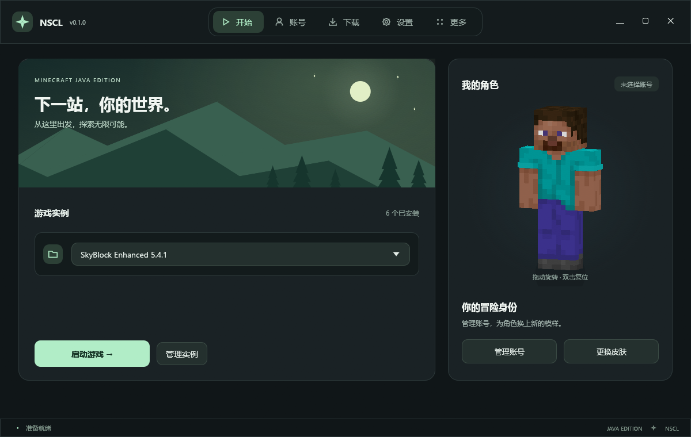
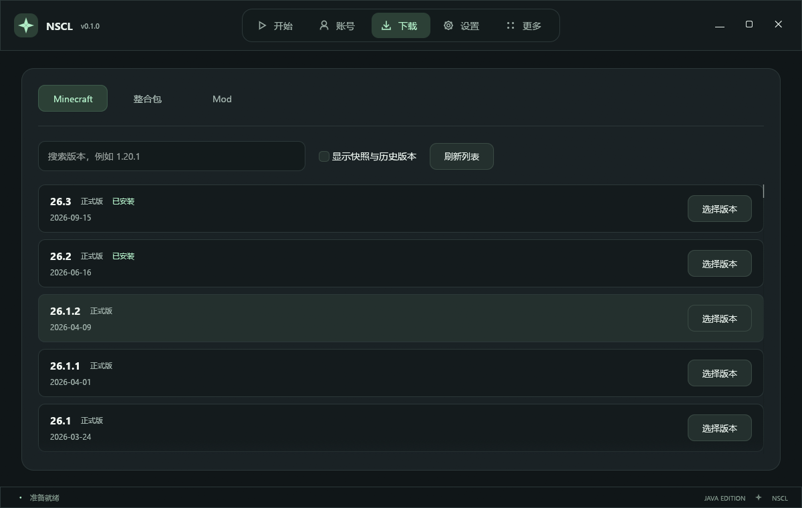

  
  <h1>NorthStar Minecraft Launcher</h1>
  
Minecraft Java Edition 桌面启动器

  

    
    
    
  

  

    <a href="#功能特性">功能特性</a> ·
    <a href="#快速开始">快速开始</a> ·
    <a href="https://github.com/JeffreyMing2004/NorthStar-Minecraft-Launcher/issues">问题反馈</a> ·
    <a href="https://cnb.cool/JeffreyMing/NorthStar-Minecraft-Launcher">CNB 镜像</a>
  

---

NorthStar Minecraft Launcher（NSCL）是使用 Rust 构建的 Minecraft Java Edition 启动器，面向 Windows 10 / 11 x86_64，提供游戏安装、账号管理、独立实例、模组与整合包管理及联机功能。

## 功能特性

- **游戏安装**：安装、校验和修复 Minecraft，支持 Forge、Fabric、NeoForge、Quilt，以及核对版本后的本地 OptiFine 导入。
- **账号管理**：Microsoft 登录、Yggdrasil 外置认证、离线账号、多账号切换，以及皮肤上传、离线账号预览和正版披风选择。
- **实例管理**：独立或共享目录、分组与固定、快捷启动和迁入预览，支持内容备份、历史恢复点和独立克隆。
- **存档与截图**：世界名称、版本、模式和游玩时间，存档备份入口，截图缩略图、搜索与最近日期筛选。
- **界面与键盘**：深色、浅色、高对比度主题，界面与字体缩放、减少动画，以及键盘导航和页面快捷键。
- **内容管理**：Modrinth 模组与依赖安装，本地模组识别、批量更新及版本锁定；资源包与光影在线管理。CurseForge 接口待启用。
- **整合包**：Modrinth `.mrpack` 导入导出，支持版本预览、升级前恢复点及历史回退；CurseForge 包安装需先启用 API。
- **运行环境**：自动匹配 Java 和内存配置，支持手动调整；Windows 可下载所需 Java 运行时。
- **联机**：自动下载 frpc、测速并分配隧道，可选本地端口、发现局域网世界并检查房间环境，最多同时开放 28 个房间。
- **下载与更新**：下载源自动切换、校验续传、持久安装队列及失败重试，支持启动器更新检查。
- **运行与排障**：游戏停止与确认强制结束、实时日志搜索与过滤、按启动会话关联崩溃报告和 JVM 日志，支持导出脱敏诊断包。

## 界面预览

  
   开始页 · 游戏实例与角色入口

  
   下载页 · 自动切换来源，选择游戏版本与加载器

## 快速开始

操作说明见[使用指南](docs/user-guide.md)、[实例备份](docs/instance-backups.md)和[故障排查](docs/troubleshooting.md)。

首个公开测试版为 **v0.1.0-beta.1**（Windows x86_64 调试便携包），从 [GitHub Releases](https://github.com/JeffreyMing2004/NorthStar-Minecraft-Launcher/releases/tag/v0.1.0-beta.1) 下载 ZIP，完整解压到可写目录后运行 `NSCL.exe`。包内附使用说明、许可证和诊断指南，发布页附 SHA-256 校验清单。

测试范围、尚未完成功能与已知限制见[测试版说明](docs/releases/0.1.0-beta.1.md)。建议使用独立游戏目录测试，修改已有实例前先备份。

1. 在「设置」选择游戏目录。默认使用启动器所在目录；若目录中有 `.minecraft`，会优先使用它。
2. 在「账号」登录 Microsoft 账号，或创建离线账号。正版登录需要拥有 Minecraft Java Edition 授权。
3. 打开「下载 → Minecraft」，选择版本与加载器，确认后开始安装。下载源默认自动选择。
4. 回到「开始」选择实例，点击「启动游戏」。

已有游戏可以直接添加其 `.minecraft` 目录；本地 `.mrpack` 整合包可拖入启动器导入。

## 参考与致谢

感谢 [HMCL](https://github.com/HMCL-dev/HMCL)、[PCL](https://github.com/Meloong-Git/PCL) 和 [Axolotl Launcher](https://github.com/Axolotl-Launcher/Axolotl) 提供的设计参考，以及 [eframe / egui](https://github.com/emilk/egui)、[Modrinth](https://modrinth.com/)、[BMCLAPI](https://bmclapi2.bangbang93.com/) 和 [minguncle 镜像](https://mirror.minguncle.cn/) 等项目与服务。

## 反馈与参与

欢迎提交 [GitHub Issue](https://github.com/JeffreyMing2004/NorthStar-Minecraft-Launcher/issues) 或 Pull Request。反馈问题时，请说明启动器版本、操作系统、游戏与加载器版本、复现步骤，并附已脱敏的错误信息或日志。

源代码托管于 [GitHub](https://github.com/JeffreyMing2004/NorthStar-Minecraft-Launcher) 与 [CNB](https://cnb.cool/JeffreyMing/NorthStar-Minecraft-Launcher)。

普通分支提交和 Pull Request 会运行 Windows 调试 CI，检查格式、Clippy、全部自动测试并构建调试版二进制。主题和键盘回归覆盖三种主题、100% / 175% 缩放及 1× / 2× DPI。

## 许可与声明

本项目采用 [GNU GPL v3.0（仅限第 3 版）](LICENSE)，即 `GPL-3.0-only`。修改和再分发时请遵守许可证，并按其要求提供相应源代码。

NSCL 是独立的非官方项目，与 Mojang Studios 或 Microsoft 无隶属或背书关系。Minecraft 及相关名称、商标与素材归其各自权利人所有，Minecraft 相关素材不受本项目许可证覆盖。
