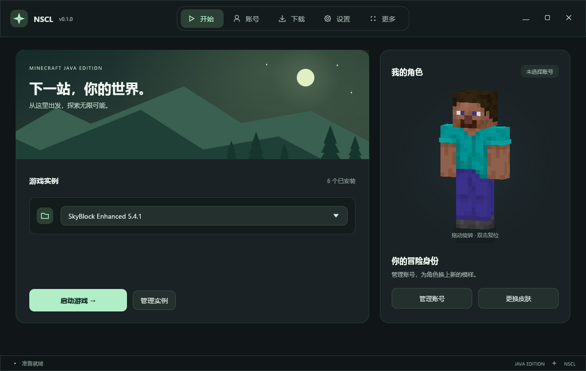
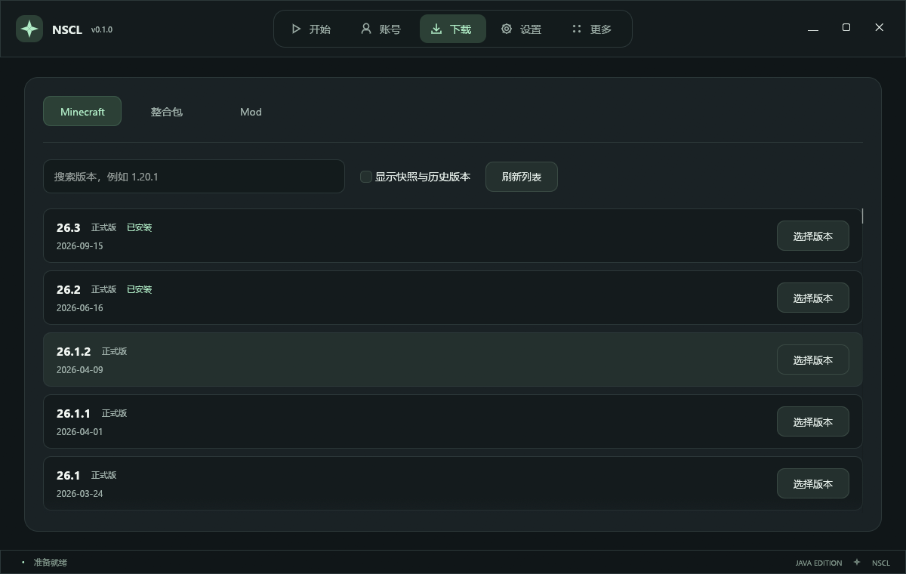
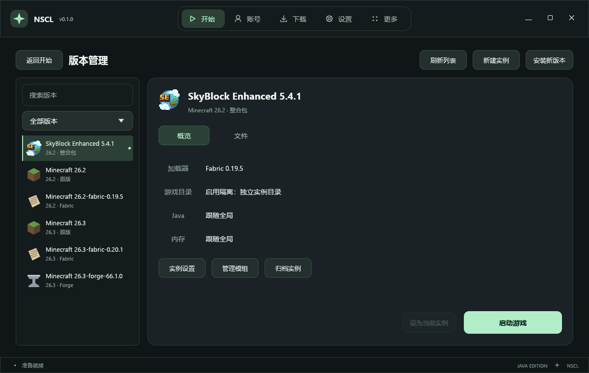
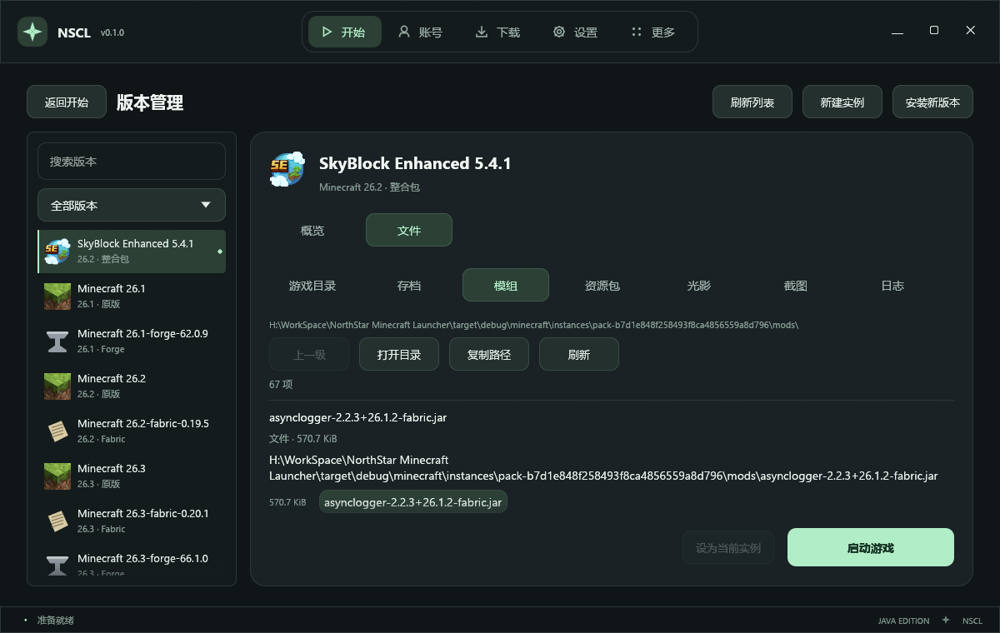

<div align="center">
  
  <h1>NorthStar Minecraft Launcher</h1>
  <p><strong>找到你的下一段方块冒险。</strong></p>
  <p>Rust 构建的 Minecraft Java Edition 桌面启动器 · 原生界面 · 独立实例 · 模组与整合包</p>
  <p>
    <a href="https://www.rust-lang.org/"></a>
    <a href="https://github.com/emilk/egui"></a>
    
    <a href="LICENSE"></a>
  </p>
  <p>
    <a href="#界面预览">界面预览</a> ·
    <a href="#功能一览">功能一览</a> ·
    <a href="#快速开始">快速开始</a> ·
    <a href="#开发与调试">开发与调试</a> ·
    <a href="https://github.com/JeffreyMing2004/NorthStar-Minecraft-Launcher/issues">问题反馈</a> ·
    <a href="https://cnb.cool/JeffreyMing/NorthStar-Minecraft-Launcher">CNB 镜像</a>
  </p>
</div>

---

NSCL 将游戏安装、账号、实例与模组管理放在一个原生窗口里。沿用已有的 Minecraft 目录，或为不同的整合包准备各自的游戏空间，从选择版本到下一次启动都在这里完成。

**项目当前处于开发与调试阶段，尚无稳定版发布。** Windows x86_64 是主要验证平台；macOS 与 Linux 尚未完成发布验证。当前请使用调试构建体验。

## 界面预览

以下为当前调试版的实际界面，使用独立预览配置，不含个人账号信息。

<p align="center">
  
  <br /><sub>开始页 · 游戏实例与角色入口</sub>
</p>

<p align="center">
  
  <br /><sub>下载页 · 自动切换来源，选择游戏版本与加载器</sub>
</p>

<details>
  <summary>版本管理 · 实例图标、搜索与分类</summary>
  <p align="center"></p>
  <p align="center"></p>
</details>

## 功能一览

<table>
  <tr>
    <td width="50%"><strong>游戏安装与修复</strong><br />浏览正式版、快照与历史版本，安装原版或 Forge、Fabric、NeoForge，校验并修复游戏文件。</td>
    <td width="50%"><strong>模组与整合包</strong><br />搜索 Modrinth 内容，安装必需依赖，检查模组兼容性与更新；支持拖入 .mrpack 与 Modrinth 格式 ZIP。</td>
  </tr>
  <tr>
    <td><strong>实例与本地资源</strong><br />实例支持独立、共享或已有版本目录；可管理模组、资源包和光影，导入文件、启用/禁用，并将移除的资源保留到本地回收目录。</td>
    <td><strong>已有游戏，继续使用</strong><br />识别 .minecraft/versions 中其他启动器安装的版本，支持中文目录名与多个游戏目录，保留原有游戏数据。</td>
  </tr>
  <tr>
    <td><strong>账号与角色</strong><br />Microsoft 浏览器授权、离线账号、多账号切换、登录续期、皮肤上传与 3D 预览，以及账号披风选择。</td>
    <td><strong>自动准备运行环境</strong><br />按游戏版本匹配 Java，按物理内存分配堆大小；Windows 支持下载 Temurin JRE，也可手动设置。</td>
  </tr>
</table>

### 88frp 联机

「联机」页提示并帮助房主从 FRP 官方下载、校验 frpc，自动测速选择北京、广州、杭州或上海节点，从映射池独占分配一条隧道并分享房间码。最多 **28 个房主同时开房**；加入者无需凭证或 frpc，不占房主名额，人数由 Minecraft 自身决定。可自部署的 `nscl-relay` 验证房主凭证并管理租约，游戏流量通过 88frp 直接传输。私有节点配置、房主登记和部署方式见 [联机部署与使用说明](docs/multiplayer.md)。

### 下载来源自动接力

默认使用「自动（BMCLAPI 优先）」，按以下顺序尝试：

```text
BMCLAPI（bangbang93） → minguncle → Mojang / 对应资源官方源
```

连接失败或文件校验不通过时，后台自动切换到下一来源。下载页只保留版本搜索、筛选与刷新等操作，无需手动选择来源；网络错误提供重试入口与可展开的技术详情。刷新失败会保留当前已加载的版本列表。

也可手动指定单个下载源或兼容 BMCLAPI 的自定义镜像。上述镜像接力适用于受支持的 Minecraft、加载器、依赖库与资源地址；Modrinth API、账号登录等请求沿用各自的服务地址。

### 更新与文件保护

- 内置 GitHub Releases 更新检查，下载后校验更新文件，替换时保留旧版备份。
- 游戏文件复用共享缓存；实例隔离分别保存存档、模组、配置等内容。
- 模组安装前检查版本、必需依赖与冲突；用户修改过的已登记文件不会被直接覆盖。

## 快速开始

1. 在「设置」选择游戏目录。默认使用启动器所在目录；若目录中有 `.minecraft`，会优先使用它。
2. 在「账号」登录 Microsoft 账号，或创建离线账号。正版登录需要拥有 Minecraft Java Edition 授权。
3. 打开「下载 → Minecraft」，选择版本与加载器，确认后开始安装。下载源默认自动选择。
4. 回到「开始」选择实例，点击「启动游戏」。

已有游戏可以直接添加其 `.minecraft` 目录。导入整合包、管理模组与隔离模式的具体行为见下方文档。

## 开发与调试

需要 Rust stable 的 MSVC 工具链，以及 Microsoft C++ Build Tools 的「使用 C++ 的桌面开发」组件。当前开发流程仅使用调试模式：

```powershell
git clone https://github.com/JeffreyMing2004/NorthStar-Minecraft-Launcher.git
cd NorthStar-Minecraft-Launcher
cargo build --locked --bin nscl
.\target\debug\nscl.exe
```

从普通桌面终端启动调试程序；受限执行环境可能限制其网络访问。网络错误诊断与连接方式说明见 [界面参考与网络排查](docs/launcher-ui-references.md)。

提交改动前执行：

```powershell
cargo fmt --all -- --check
cargo clippy --locked --all-targets -- -D warnings
cargo test --locked --all-targets
```

## 项目文档

| 内容 | 文档 |
| --- | --- |
| 原版客户端、下载与启动 | [原版客户端](docs/vanilla-client.md) |
| Forge / Fabric / NeoForge | [加载器](docs/loaders.md) |
| 模组依赖、整合包与文件保护 | [模组与整合包](docs/mods-and-modpacks.md) |
| 登录、实例与目录隔离 | [账号与实例](docs/accounts-and-instances.md) |
| 启动器黑屏、VMware 与图形日志 | [图形排查](docs/graphics-troubleshooting.md) |
| 启动器更新 | [更新机制](docs/launcher-updates.md) |
| 界面参考、功能对比与联网排查 | [界面参考](docs/launcher-ui-references.md) |

## 参考与致谢

感谢 Minecraft 启动器社区积累的设计与经验。以下项目为 NSCL 的界面与交互设计提供了参考，启动器的「关于」页面也保留了对应链接：

- [HMCL · Hello Minecraft! Launcher](https://github.com/HMCL-dev/HMCL)：安装组件分组与兼容性呈现。
- [PCL · Plain Craft Launcher](https://github.com/Meloong-Git/PCL)：资源分类与分步安装交互。
- [Axolotl Launcher](https://github.com/Axolotl-Launcher/Axolotl)：实例与内容管理，以及本 README 的组织方式。

同时感谢 [eframe / egui](https://github.com/emilk/egui)、[Modrinth](https://modrinth.com/)、[BMCLAPI（bangbang93）](https://bmclapi2.bangbang93.com/) 与 [minguncle 镜像](https://mirror.minguncle.cn/) 等项目和服务。

## 反馈与参与

欢迎提交 [GitHub Issue](https://github.com/JeffreyMing2004/NorthStar-Minecraft-Launcher/issues) 或 Pull Request。反馈问题时，请说明启动器版本、操作系统、游戏与加载器版本、复现步骤，并附已脱敏的错误信息或日志。

源代码托管于 [GitHub](https://github.com/JeffreyMing2004/NorthStar-Minecraft-Launcher) 与 [CNB](https://cnb.cool/JeffreyMing/NorthStar-Minecraft-Launcher)。

## 许可与声明

本项目采用 [GNU GPL v3.0（仅限第 3 版）](LICENSE)，即 `GPL-3.0-only`。修改和再分发时请遵守许可证，并按其要求提供相应源代码。

NSCL 是独立的非官方项目，与 Mojang Studios 或 Microsoft 无隶属或背书关系。Minecraft 及相关名称、商标与素材归其各自权利人所有，Minecraft 相关素材不受本项目许可证覆盖。
